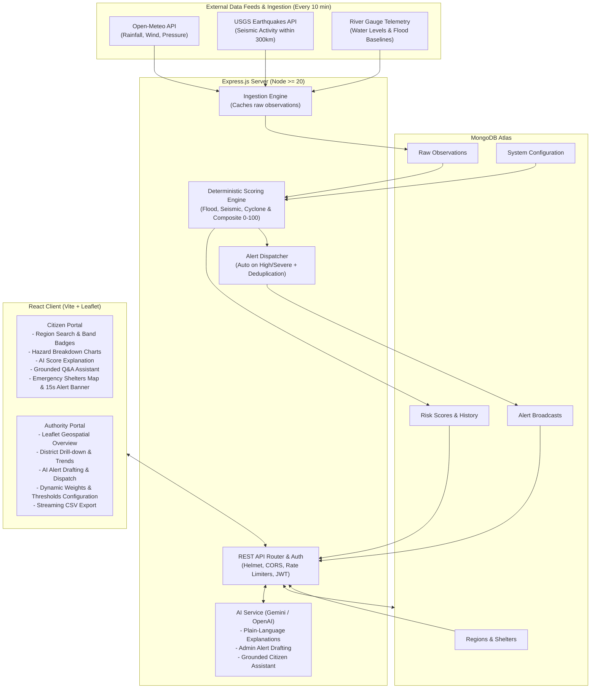

# Multi-Hazard Early Warning Dashboard

A full-stack, real-time disaster management and decision-support web platform that aggregates live environmental telemetry (Open-Meteo weather, USGS seismic events, and river gauge levels) to compute an explainable, deterministic 0–100 Regional Risk Score across floods, earthquakes, and cyclones for Indian districts.

Features citizen-facing advisory portals with emergency shelter locations and LLM-grounded guidance, paired with an administrative console offering geospatial map monitoring, automated alert broadcast, dynamic weight re-tuning, and streaming CSV data exports.

---

## Architecture



---

## Tech Stack

- **Backend**: Node.js (ES modules, Node 20+), Express 4.x, Mongoose 9.x, node-cron, Helmet, CORS, Express-Rate-Limit, Bcrypt.js, JsonWebToken.
- **AI / LLM Integration**: Google Gemini API (`@google/genai`) or OpenAI (`openai`), strictly sandboxed for explanatory and drafting tasks without changing numerical scores.
- **Database**: MongoDB (local or MongoDB Atlas) with indexed spatial and temporal querying.
- **Frontend**: React 18, Vite, React Router 6, Leaflet & React-Leaflet, Chart.js & React-Chartjs-2.
- **Testing**: Jest 29, Supertest 7, Mocked API & LLM suites (10 suites, 112+ unit and integration tests).

---

## Local Setup

### Prerequisites
- **Node.js**: v20.0.0 or higher
- **npm**: v9.0.0 or higher
- **MongoDB**: Local MongoDB instance running on `mongodb://localhost:27017` or a MongoDB Atlas connection URI.

### 1. Server Configuration & Setup

```bash
cd multi-hazard-dashboard/server

# Install dependencies
npm install

# Configure environment variables
cp .env.example .env
# Edit .env and supply your MONGODB_URI and LLM_API_KEY

# Seed Indian districts, verified shelters, and baseline configuration
npm run seed

# Run ingestion cycle manually to fetch live weather & seismic data
npm run ingest

# Compute hazard risk scores across all districts
npm run score

# Start the backend server in development mode
npm run dev
```

Server will be running at `http://localhost:5000`. Verify health:
```bash
curl http://localhost:5000/api/health
```

### 2. Client Configuration & Setup

```bash
cd ../client

# Install dependencies
npm install

# Configure environment variables
cp .env.example .env
# Default points to http://localhost:5000/api

# Start Vite development server
npm run dev
```

Open your browser at `http://localhost:5173`.

### 3. Creating Production Admin User
To create or update an administrator without relying on default seed credentials:
```bash
cd multi-hazard-dashboard/server
ADMIN_EMAIL="officer@disaster.gov.in" ADMIN_PASSWORD="SecureAdminPassword2026!" npm run create-admin
```

---

## Environment Variables

### Server (`server/.env`)

| Variable | Required | Default | Description |
| :--- | :---: | :--- | :--- |
| `PORT` | No | `5000` | HTTP port the Express server listens on. |
| `NODE_ENV` | No | `development` | Environment mode (`development`, `production`, `test`). |
| `MONGODB_URI` | **Yes** | — | MongoDB connection string (local or Atlas URI). |
| `JWT_SECRET` | **Yes** | — | Secret key for JWT signing. Must be $\ge 32$ chars in production. |
| `CLIENT_ORIGIN` | No | `http://localhost:5173` | Comma-separated list of allowed CORS origins for client apps. |
| `LLM_PROVIDER` | No | `gemini` | AI provider for summaries and drafting (`gemini` or `openai`). |
| `LLM_API_KEY` | No | — | API key for Google Gemini or OpenAI. |
| `LLM_MODEL` | No | `gemini-1.5-flash` | LLM model identifier. |
| `ADMIN_EMAIL` | For Script | — | Admin email used by `npm run create-admin`. |
| `ADMIN_PASSWORD`| For Script | — | Admin password used by `npm run create-admin` (min 12 chars). |

### Client (`client/.env`)

| Variable | Required | Default | Description |
| :--- | :---: | :--- | :--- |
| `VITE_API_URL` | No | `http://localhost:5000/api` | Base URL of the backend API. |

---

## Deployment Guide

### 1. MongoDB Atlas
1. Create a free M0 cluster in your desired cloud region (e.g. AWS Mumbai).
2. Under **Database Access**, create a database user and record the credentials.
3. Under **Network Access**, allow access from anywhere (`0.0.0.0/0`) or whitelist your Render egress IPs.
4. Copy the connection URI: `mongodb+srv://<user>:<password>@cluster.mongodb.net/hazard_db?retryWrites=true&w=majority`.

### 2. Backend on Render
1. Create a new **Web Service** on [Render](https://render.com).
2. Connect your Git repository.
3. Configure the service settings:
   - **Root Directory**: `multi-hazard-dashboard/server`
   - **Environment**: `Node`
   - **Build Command**: `npm install`
   - **Start Command**: `npm start`
   - **Health Check Path**: `/api/health`
4. In **Environment Variables**, set:
   - `NODE_ENV`: `production`
   - `MONGODB_URI`: `<Your MongoDB Atlas connection URI>`
   - `JWT_SECRET`: `<A random, secure string of at least 32 characters>`
   - `CLIENT_ORIGIN`: `https://<your-vercel-app-name>.vercel.app`
   - `LLM_PROVIDER`: `gemini` (or `openai`)
   - `LLM_API_KEY`: `<Your Gemini or OpenAI API Key>`
   - `LLM_MODEL`: `gemini-1.5-flash`
5. Deploy the service and run `npm run seed` or `npm run create-admin` via Render Shell.

### 3. Frontend on Vercel
1. Create a new project on [Vercel](https://vercel.com) and import the repository.
2. Configure project settings:
   - **Root Directory**: `multi-hazard-dashboard/client`
   - **Framework Preset**: `Vite`
   - **Build Command**: `npm run build`
   - **Output Directory**: `dist`
3. Add Environment Variable:
   - `VITE_API_URL`: `https://<your-render-service-name>.onrender.com/api`
4. The included `client/vercel.json` automatically rewrites all SPA routes (e.g., `/admin/alerts`, `/login`) to `/index.html`.
5. Deploy.

---

## 5-Step Demo Script

1. **Explore Citizen District Monitoring**:
   - Open the Citizen Home page (`/`).
   - Observe the interactive map displaying monitored Indian districts (Puri, Uttarkashi, Wayanad, Cuttack, etc.) with color-coded risk badges (**Low**, **Medium**, **High**, **Severe**) and stale data badges.
   - Select **Puri** to view its real-time 0–100 composite risk score, danger band, and flood/seismic/cyclone index breakdown.

2. **Trigger AI Plain-Language Explanation**:
   - Under the Puri score card, click the **"Explain this score"** button.
   - The system calls the rate-limited AI explanation endpoint and renders a concise, 2–3 sentence plain-language summary with 3 actionable safety tips.
   - Click again or change tabs to verify the explanation is cached and does not redundantly re-invoke the LLM.

3. **Interact with Grounded Citizen Assistant**:
   - Scroll to the **Citizen Assistant** panel at the bottom of the Home page.
   - Click suggestion chips such as *"What does this risk level mean?"* or *"Where is the nearest shelter?"*.
   - Notice the AI assistant strictly bounds its answer to Puri's telemetry and designated shelter locations, refusing off-topic queries and displaying emergency 112 disclaimers.

4. **Authority Login & AI Alert Drafting**:
   - Click **Admin Portal** in the navigation bar and log in with your administrative credentials.
   - In the **Alerts** section (`/admin/alerts`), click **"Draft with AI"**.
   - Select a tone (*Urgent*) and language (*Hindi* or *English*). The system generates a safety advisory constrained to 400 characters into the editable message box.
   - Review and click **Send Alert** to broadcast. A simulated SMS/Email alert is logged and an emergency banner appears on the citizen portal within 15 seconds.

5. **Dynamic Scoring Re-weighting & CSV Export**:
   - Navigate to **Settings** (`/admin/settings`).
   - Adjust the hazard model weights (e.g., increasing Cyclone weight for coastal seasons) or modify band threshold cutoffs.
   - Save changes to observe instantaneous server-side score recalculation.
   - Visit **Region Detail** (`/admin/regions/:id`) and click **Download CSV** to stream complete historical sensor and score telemetry.

---

## API Endpoints

### Public / Citizen Endpoints
- `GET /api/health` — Service health check, uptime, and server timestamp.
- `GET /api/regions` — List all monitored regions with coordinates, population, and latest composite score.
- `GET /api/regions/:id/score` — Latest risk score, component indices (flood, seismic, cyclone), band, and staleness flag.
- `GET /api/regions/:id/shelters` — Verified emergency shelters for a region with capacity and coordinates.
- `GET /api/regions/:id/history` — Historical risk scores sorted chronologically (7-day or 30-day window).
- `GET /api/regions/:id/export` — Stream historical scores as a downloadable CSV.
- `GET /api/alerts` — Active public alerts (polled by client every 15s).
- `POST /api/ai/explain/:scoreId` — Generates and caches plain-language score breakdown and safety tips.
- `POST /api/ai/assistant` — Read-only citizen Q&A assistant (rate limited to 10 req/min and 100 req/day per IP).
- `POST /api/auth/login` — Administrative authentication (returns 8-hour JWT).

### Authority / Admin Endpoints (Requires `Authorization: Bearer <token>`)
- `GET /api/admin/config` — Retrieve dynamic hazard weights and band boundary thresholds.
- `PUT /api/admin/config` — Update weights and thresholds, triggering automatic rescore across all regions.
- `POST /api/admin/alerts` — Manually create and broadcast an emergency alert to citizens.
- `POST /api/admin/ai/draft-alert` — Generate an AI draft alert (validated tone and language, max 400 chars).

---

## Limitations

- **River Gauge Data**: River gauge observations currently utilize a synthetic dataset derived from historical Central Water Commission (CWC) monsoonal water level baselines, as live telemetry feeds require restricted intranet access.
- **Cyclone Index Formulation**: The cyclone index represents an operational meteorological proxy derived from sustained surface wind speeds ($km/h$) and sea-level barometric pressure drops rather than Doppler radar velocity vectors.
- **Heuristic Scoring Model**: Regional risk scores are computed using an empirical weighted heuristic (0–100) intended for decision prototyping and emergency drill coordination; they are not formally certified by NDRF or IMD for official operational command.
- **Simulated Notification Channels**: SMS and email alert broadcasts are dispatched to simulated background logging stubs rather than live telecommunications carrier gateways.
- **Render Free Tier Spin-Down**: When hosted on Render's free tier, the web service automatically spins down after 15 minutes of inactivity. The initial cold request may experience a 30–50 second latency, after which the built-in cold-start catch-up automatically verifies and updates any stale observations.
